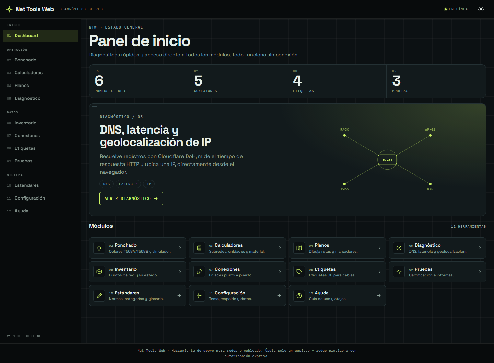
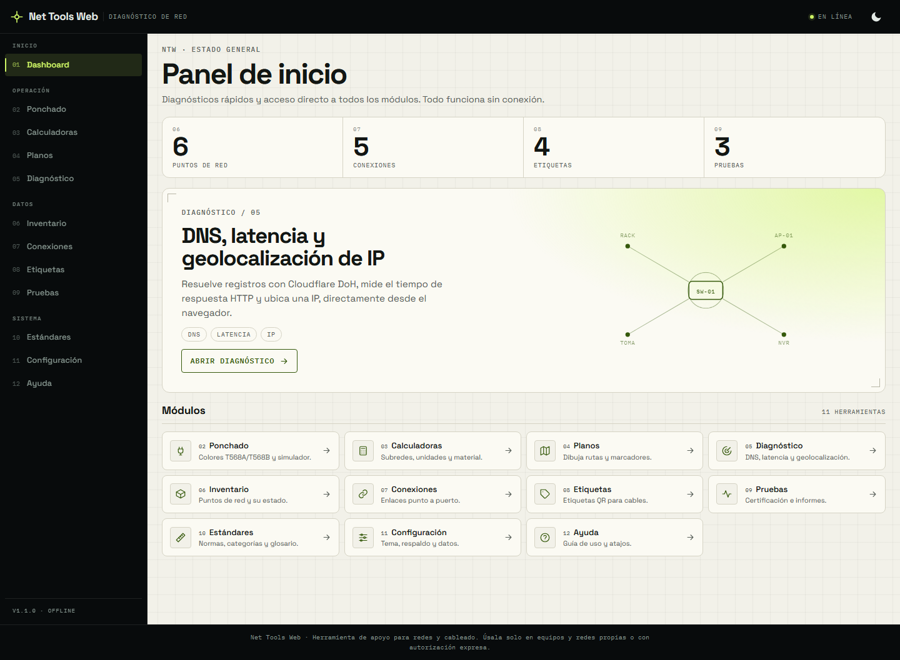
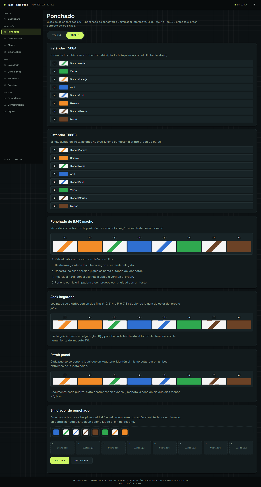
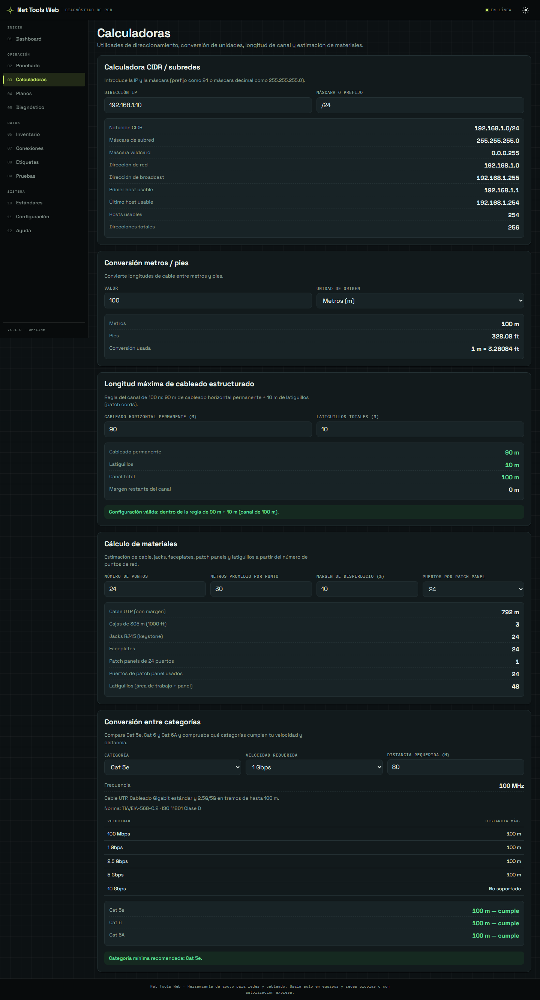
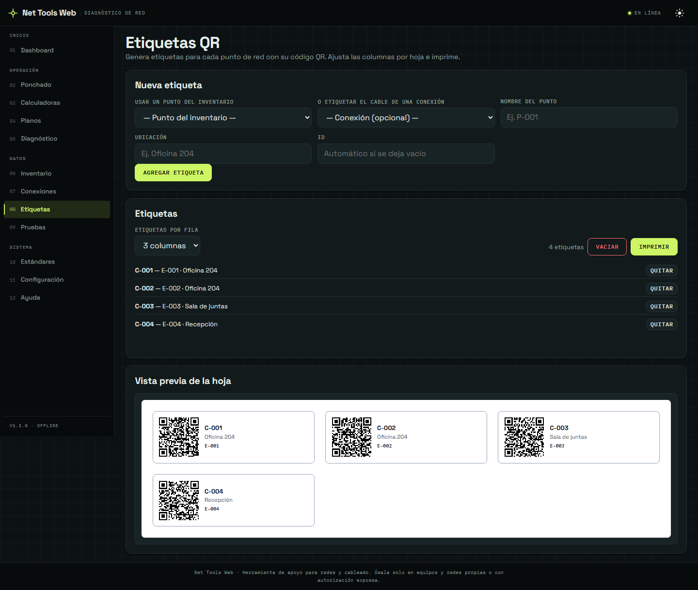
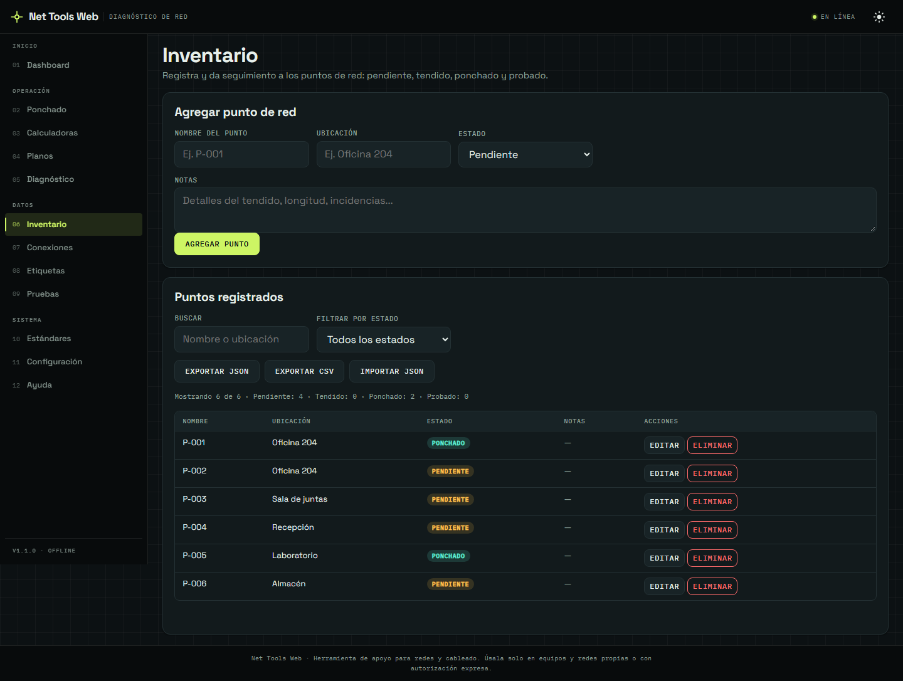
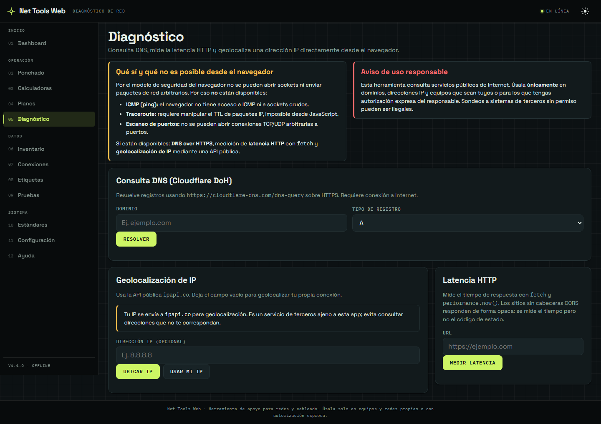
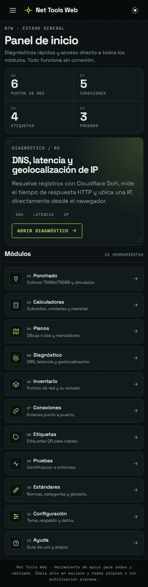

# Net Tools Web — PWA de diagnóstico de red para técnicos de campo

[](https://neffex010.github.io/net-tools-web/)
[](#cómo-correr-los-tests)
[](LICENSE)

Aplicación web **100 % frontend** (sin backend ni base de datos) para redes,
cableado, ponchado e instalación. Funciona instalada como PWA y sin conexión:
los datos viven en `localStorage` (claves `ntw:*`) o en archivos JSON exportados
por el usuario.

## Capturas



| Tema claro | Ponchado |
|---|---|
|  |  |

| Calculadoras | Etiquetas QR |
|---|---|
|  |  |

| Inventario | Diagnóstico |
|---|---|
|  |  |

<p align="center">
  
</p>

## Diseño

Dirección visual de **panel de instrumento**: chasis oscuro fijo (barra superior y
menú), superficie de papel cálido en el tema claro y pantalla tinta en el oscuro,
con **lima de señal** como único acento. La interfaz usa **Space Grotesk** y los
datos, etiquetas y numeración de módulos usan **IBM Plex Mono**; ambas se sirven
autoalojadas (`assets/fonts/`) para que la PWA siga funcionando sin conexión.

El dashboard usa una tira de lectura tipo instrumento y un índice de módulos
numerado. El resto de vistas comparte los mismos tokens, una retícula técnica de
fondo y una capa compacta global que evita repetir ajustes de densidad.

## Para quién es

Técnicos de campo e instaladores de redes que necesitan documentar su trabajo
desde el móvil o el portátil, sin depender de servidores ni de una cuenta.

## Qué problema resuelve

Centraliza en una sola app tareas que suelen repartirse entre papel, hojas de
cálculo y varias webs: inventario de puntos de red, planos, cálculo de material,
certificación de enlaces, etiquetas imprimibles y consultas de red (DNS,
latencia, geolocalización de IP). Todo funciona offline, así que sirve en sótanos,
cuartos de telecomunicaciones o cualquier sitio sin cobertura.

## Módulos incluidos

| Módulo | Qué hace |
|---|---|
| Dashboard | Contadores de Inventario, Pruebas, Conexiones y Etiquetas. |
| Ponchado | Guía de colores y estándares T568A/T568B + simulador de ponchado. |
| Calculadoras | Cálculo de material (cable, jacks, faceplates, patch panels…) y especificaciones por categoría. |
| Planos | Diseño de planos en canvas; exportación a PNG/JSON (en memoria, no persiste). |
| Inventario | CRUD de puntos de red con filtros, búsqueda y exportación a JSON/CSV. |
| Conexiones | Vinculación punto ↔ switch/panel con cable; exportación a JSON/CSV. |
| Etiquetas | Etiquetas con QR imprimibles, creadas desde un punto o una conexión. |
| Pruebas | Certificación de enlaces con límites de referencia e informe imprimible + CSV. |
| Estándares | Consulta de estándares de cableado y glosario. |
| Diagnóstico | DNS (Cloudflare DoH), medición de latencia HTTP y geolocalización de IP. |
| Configuración | Preferencias y respaldo/restauración de datos. |
| Ayuda | Documentación de uso dentro de la app. |

## Stack

- **JavaScript vanilla** con ES Modules; **sin framework ni build tool**.
- SPA con router por *hash* (`js/router.js`).
- PWA: `service-worker.js` (caché versionada + modo offline) y `manifest.webmanifest`.
- Estilos en CSS plano (`css/`), con tokens de diseño y dos temas. Tipografías
  autoalojadas (Space Grotesk + IBM Plex Mono, SIL OFL 1.1).
- QR mediante librería vendorizada (`js/libs/qrcode.min.js`).
- Pruebas E2E con **Playwright** (devDependency) y un servidor HTTP propio.

## Cómo correr

El service worker solo se registra sobre `http(s)`. Abrir `index.html` con
`file://` funciona, pero sin PWA ni modo offline.

```bash
# Opción 1 (Python)
python -m http.server 8080

# Opción 2 (Node, sin dependencias)
npm install   # instala Playwright (solo la primera vez)
npm run serve
```

Luego abre `http://127.0.0.1:8080`.

## Cómo correr los tests

Suite E2E con Playwright + servidor HTTP propio de Node (sin dependencias extra):

```bash
npm install   # instala Playwright (devDependency)
npm test      # corre tests/e2e.spec.cjs
```

La suite levanta el servidor en un puerto efímero, instala el service worker en
un perfil limpio y verifica **37 comprobaciones**: precache versionado (incluidas
las fuentes), banner de actualización, dashboard, índice de módulos, vinculación
Conexiones → Pruebas/Etiquetas, búsqueda en Conexiones, exportaciones CSV con BOM,
borrado en cascada de puntos, modo offline, tema del sistema, menú móvil accesible
y ausencia de errores de consola.

## Demo

**https://neffex010.github.io/net-tools-web/**

El proyecto es estático y se publica con **GitHub Pages** desde la rama `main`
(raíz del repositorio) en cada push. Todas las rutas son relativas, así que
también funciona en Netlify, Cloudflare Pages o cualquier hosting de archivos
sin cambios.

## Aviso legal

Esta aplicación consulta **servicios públicos de Internet** y está pensada como
herramienta de apoyo. Úsala **únicamente** en dominios, direcciones IP, equipos y
redes que sean tuyos o para los que tengas **autorización expresa** del
responsable. El sondeo de sistemas de terceros sin permiso puede ser ilegal.

- El módulo **Diagnóstico** resuelve DNS vía `https://cloudflare-dns.com/dns-query`
  y geolocaliza IPs vía **`ipapi.co`**: tu IP se envía a esos servicios de
  terceros, que tienen sus propias políticas de uso y de datos.
- La geolocalización depende del plan gratuito de `ipapi.co` (1000 consultas/día);
  al agotarse la cuota la app lo indica y no reintenta.

## Limitaciones conocidas

- **Sin backend**, así que no hay WHOIS, escaneo de puertos, SSL/TLS, cabeceras
  HTTP, subdominios ni detección de tecnologías.
- **Ping (ICMP) y traceroute no son posibles** desde el navegador: no hay acceso
  a sockets ni a paquetes crudos. La "latencia" que muestra Diagnóstico es el
  tiempo de respuesta HTTP (`fetch` + `performance.now()`), no ICMP.
- Los sitios sin cabeceras CORS responden de forma **opaca**: se mide el tiempo,
  pero no el código de estado.
- **Planos** no persiste entre sesiones: la exportación es en memoria (descarga).
- **CSP**: `script-src 'self'` estricto; `style-src` incluye `'unsafe-inline'`
  porque las vistas y plantillas inyectan su propio `<style>`.
- **Sin sincronización entre pestañas**: los contadores del dashboard se
  actualizan al navegar, no en vivo (pendiente en el roadmap).

## Estructura

```
assets/     -> íconos, imágenes, fuentes
css/        -> estilos (reset, variables, temas, layout)
js/         -> main.js (arranque), router.js (SPA), store.js (datos), utils.js (helpers), modules/, libs/
pages/      -> vistas de la SPA
data/       -> JSON estáticos (colores, estándares, glosario)
templates/  -> plantillas para etiquetas e informes (impresión)
tests/      -> suite E2E persistente (server.js + e2e.spec.cjs)
docs/       -> documentación del proyecto
```

## Notas de mantenimiento

- Al publicar cambios: subir `APP_VERSION` en `service-worker.js` y el meta
  `ntw-version` en `index.html` (deben coincidir). La suite de pruebas lee la
  versión del propio service worker, así que no hay que tocarla.
- Los CSV de Inventario y Conexiones usan `;` + BOM UTF-8 (abren directo en Excel
  es-MX); el CSV de Pruebas usa `,`.
- Las capturas de `docs/screenshots/` se generan con Playwright sobre datos de
  ejemplo; conviene regenerarlas si cambia la interfaz.
- Las fuentes de `assets/fonts/` son SIL OFL 1.1; el texto de la licencia está en
  `assets/fonts/OFL.txt`. Si se cambian, actualizar `css/fonts.css` y el precache.
- Más detalles en [docs/arquitectura.md](docs/arquitectura.md),
  [docs/guia-uso.md](docs/guia-uso.md) y [docs/roadmap.md](docs/roadmap.md).

## Licencia

MIT © 2026 Neffex010. Ver [LICENSE](LICENSE).
Las tipografías incluidas son SIL OFL 1.1 (ver [assets/fonts/OFL.txt](assets/fonts/OFL.txt)).
